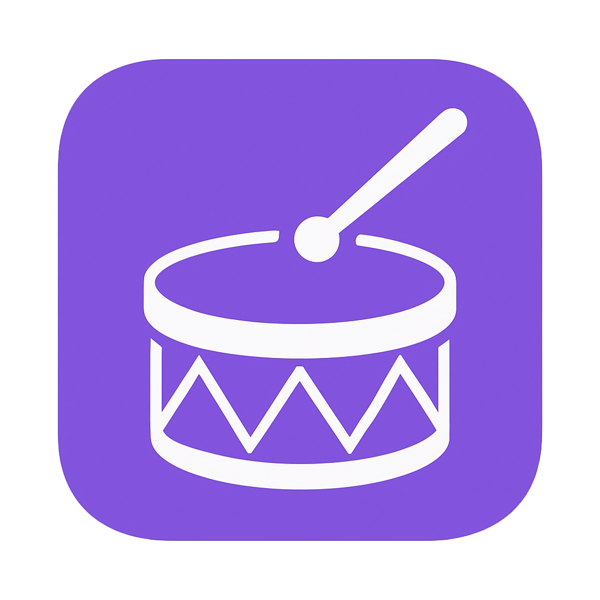

<!-- prettier-ignore -->
<div align="center">



# BeatSight

**See the music before you play it.**

[](https://github.com/rosacry/BeatSight/actions)
[](https://github.com/rosacry/BeatSight/tree/main/backend/tests)
[](https://codecov.io/gh/rosacry/BeatSight)


[](LICENSE)

[Current state](#current-state-november-2026) • [Why BeatSight](#why-beatsight) • [Features](#features) • [Getting Started](#getting-started) • [Architecture](#architecture) • [Contributing](#contributing)

:dart: **Live at [beatsight.io](https://beatsight.io)** | :books: **[API Docs](https://api.beatsight.io/docs)**

</div>

---

## Current state (November 2026)

Recent work has focused on the hardest part of the product: turning a full commercial song into a playable,
instrument-accurate drum chart.

**Transcription engine.** [`ai-pipeline/adtof_engine/`](ai-pipeline/adtof_engine) is a PyTorch implementation
of the ADTOF Frame_RNN drum transcriber (Zehren et al.). It runs on a Demucs (htdemucs_ft) drum stem. Its
features, peak picking and outputs match the reference implementation in audited tests. It is the default
engine in the app.

**16-class model.** ADTOF only reports five families: kick, snare, tom, hi-hat and cymbal. BeatSight's own
model, fine-tuned from it, reports 16 instruments: closed, open and pedal hi-hat; ride, ride bell, crash,
china and splash; high, mid and floor tom; snare, cross-stick, kick, cowbell; and other percussion.
- Phase 1 trains on synthetic and electronic-kit datasets (STAR, E-GMD, Slakh, Groove).
- Phase 2 adds 6,809 community rhythm-game charts (447 hours) aligned to their recordings. Those charts only
  have five lanes, so a grouped (noisy-OR) loss teaches the fine classes through the lanes.
- Phase 2 also adds a cymbal/hi-hat exclusivity term and a learned ghost-note head.

**How it is measured.** Results come from frozen, held-out test sets that the model never trained on:
- 202 charted songs from 98 artists, resampled by artist.
- Real-recording, commercial-chart and e-drum sets.

Each run's protocol is frozen and hashed before any result exists. Differences use paired bootstrap 95%
intervals.

| Held-out test set (F1 at 50 ms, as the app decodes) | ADTOF baseline | BeatSight 16-class | Difference [95% CI] |
|---|---|---|---|
| 202 charted songs, all five families | .874 | **.904** | +.030 [+.023, +.037] |
| … cymbals | .727 | **.815** | +.087 [+.065, +.113] |
| … hi-hat | .707 | **.788** | +.081 [+.062, +.099] |
| 48 real recordings | .829 | **.859** | +.029 [+.010, +.052] |
| 40 e-drum performances | .730 | **.840** | +.110 [+.070, +.150] |
| 23 real recordings, fully held out | .643 | .622 | −.022 [−.066, +.027] (not significant) |

**Ghost notes.** A separate head finds ghost snares. On 73 held-out songs it scores F1 .820 (AUROC .977),
compared with .604 for a loudness rule.

**Known limits:**
- Low-bitrate MP3s lose fast double-bass detail.
- Chart conventions for ride vs crash vary between charters.
- The newest run detects toms less well than the previous one (−.032 on the 202 songs).
- The desktop still defaults to the five-family engine while listening tests continue.

Model weights are not distributed: they derive from ADTOF weights licensed CC BY-NC-SA 4.0.

**Desktop.** The UI was redesigned around an instrument colour palette, with per-tom lanes and an editor
layout pass. A new drum-staff notation view is engraved from the chart, with standard drum key, beaming
and tuplets.

**Write-ups:**
- [Phase 2, run 2 results](docs/PHASE2_RUN2_RESULTS_2026-11-07.md)
- [Run 1 results](docs/PHASE2_RUN1_RESULTS_2026-10-23.md)
- [Evaluation set](docs/EVAL_SET_V1_2026-10-16.md)
- [Phase 2 plan](docs/PHASE2_PLAN_DRAFT_2026-10-18.md)
- [UI audit](docs/UI_AUDIT_AND_DIRECTION_2026-10-24.md)
- [Recovery audit](docs/RECOVERY_AUDIT_2026-10-13.md)

## Why BeatSight?

Rhythm games like Guitar Hero, Rock Band, Dance Dance Revolution, and osu! all share one key mechanic: notes scroll toward a timing line *before* you need to hit them. This visual lookahead is what enables rapid skill acquisition—you see what's coming and your brain pre-plans the movement. But when drummers want to learn *real songs on real drums*, they're stuck memorizing by ear, rewinding the same 4-bar section dozens of times, or squinting at static sheet music that offers no timing guidance.

BeatSight brings the rhythm game paradigm to drum practice:

- **Visual lookahead** — Notes scroll toward a timing line, giving you time to prepare each hit
- **Community library** — The first universal index for drum transcriptions: discover, share, and refine beatmaps for any song
- **Multiple creation paths** — Build maps from scratch, use AI-assisted transcription, or polish existing community maps
- **12-class detection** — kick, snare, hi-hat types, ride bow/bell, toms, crash, china, splash; simultaneous hits, ghost notes, velocity
- **Tempo control** — Slow sections down to 50% without pitch shift, then gradually speed up as you learn
- **Stem isolation** — Practice with just the drum track, or hear how your part fits the full mix

The goal isn't gamification for its own sake—it's giving drummers the same visual-motor advantage that rhythm games have proven works, applied to learning *actual songs* on *real drums*, with a community-driven library that grows and improves over time.

## Features

### AI-Powered Transcription
- **12 drum classes** — Comprehensive detection: kick, snare, cross-stick, hi-hat (closed/open/pedal), ride (bow/bell), toms, crash, china, splash
- **Multi-label detection** — Detects simultaneous hits (kick+hi-hat, snare+crash) unlike single-label competitors
- **Pitch ranking** — Distinguishes tom_1/tom_2/tom_3 and crash_1/crash_2 by pitch analysis
- **Measured on held-out songs** — see [Current state](#current-state-november-2026). Accuracy figures from the earlier (pre-2026) pipeline could not be verified and are no longer quoted.

### Beatmap Creation
- **Manual editor** — Build beatmaps from scratch with a full-featured timeline editor
- **AI-assisted transcription** — Use machine learning to generate a starting point, then refine it
- **Community refinement** — Polish existing maps; your corrections feed back to improve the model
- **Automatic analysis** — Tempo, time signature, and velocity detection

### Multiple Practice Views
- **2D Lane View** — DDR/StepMania-style vertical scrolling with color-coded drum components
- **3D Highway** — Guitar Hero-inspired perspective with depth and scanline effects
- **Notation View** — Standard drum-key staff notation engraved from the chart (beaming, tuplets, dotted rhythms)

### Practice Tools
- Stem isolation (drums vs. full mix) via Demucs source separation
- Pitch-independent tempo adjustment (50%–200%)
- Section looping with visual loop markers
- Metronome overlay with configurable accents
- Progress tracking: favorites, tags, notes, and difficult section marking

### Platforms

| Platform | Description | Status |
|----------|-------------|--------|
| **Desktop** | Full-featured practice environment built on osu!-framework | :white_check_mark: Available |
| **Web** | Library management, uploads, AI job tracking at [beatsight.io](https://beatsight.io) | :white_check_mark: Live |
| **API** | RESTful API at [api.beatsight.io](https://api.beatsight.io/docs) | :white_check_mark: Live |
| **Mobile** | Flutter-based iOS/Android clients | :calendar: Planned |

> [!NOTE]
> Community beatmaps and manually-created maps are always free to access and play. AI-assisted transcription uses account credits and runs on secure cloud infrastructure (Modal)—manual creation is unlimited.

## Getting Started

### Prerequisites

| Tool | Version | Purpose |
|------|---------|---------|
| .NET SDK | 8.0+ | Desktop client |
| Python | 3.10+ | Backend services |
| Node.js | 20.19+ (or 22.12+) | Web frontend |
| FFmpeg | Latest | Audio processing |
| PostgreSQL | 15+ | Database |
| Redis | 7+ | Caching |

> [!TIP]
> See [`docs/SETUP.md`](docs/SETUP.md) for detailed platform-specific installation guides (Windows, macOS, Linux).

### Desktop Client

```bash
cd desktop/BeatSight.Desktop
dotnet restore
dotnet run
```

The desktop app connects to beatsight.io for AI transcription. Sign in with your account to use your credits or free tier quota.

<details>
<summary><strong>Backend API (for developers)</strong></summary>

```bash
cd backend
pip install -e ".[dev]"

# Start dependencies
docker compose up -d  # PostgreSQL + Redis

# Run migrations
alembic upgrade head

# Start server
uvicorn app.main:app --reload
```

API available at `http://localhost:8000`. Health check: `GET /health/live`. Interactive docs at `/docs`.

</details>

<details>
<summary><strong>Web Frontend (for developers)</strong></summary>

```bash
cd frontend
npm install
npm run dev
```

Opens at `http://localhost:5173` with hot module replacement.

</details>

## Pricing

**Playing and creating beatmaps is free.** AI-assisted transcription uses credits:

| Tier | Price | AI Transcriptions | Best For |
|------|-------|-------------------|----------|
| **Free** | $0 | 3/month | Getting started |
| **Pro** | $12/mo ($8/mo yearly) | 50/month | Regular creators |
| **Credits** | ~$0.33/song | Pay-as-you-go | Extra songs beyond quota |

Community maps, manual creation, verification, and all practice features are always free. Credits are only for AI-assisted transcription beyond your monthly quota.

## Architecture

```
BeatSight/
├── desktop/                  # osu-framework desktop client (C#/.NET 8)
│   ├── BeatSight.Desktop/    # Platform host & window management
│   ├── BeatSight.Game/       # Playback screens, editor, UI components
│   └── BeatSight.Tests/      # Unit tests (479 tests)
├── ai-pipeline/              # ML training & inference pipeline (Python)
│   ├── adtof_engine/         # Default transcription engine + 16-class models
│   ├── pipeline/             # Audio processing orchestration
│   ├── training/             # Model training scripts & configs
│   ├── transcription/        # Onset detection, drum classification
│   └── separation/           # Demucs source separation
├── backend/                  # FastAPI web services (Python)
│   └── app/                  # API routes, services, models (2895 tests, 84% coverage)
├── frontend/                 # React + TypeScript SPA (283 tests)
│   └── src/                  # Components, hooks, state management
├── docs/                     # Architecture, guides, specifications
├── data/                     # Dataset storage (gitignored)
└── shared/                   # Format specs, shared assets
```

### Tech Stack

| Component | Stack | Tests/Coverage |
|-----------|-------|----------------|
| Desktop | osu-framework, .NET 8, OpenGL | 479 tests |
| Backend | FastAPI, SQLAlchemy, PostgreSQL, Redis | 2895 tests, 84% cov |
| Frontend | React 18, TypeScript, TailwindCSS, Vite | 283 tests |
| AI Pipeline | PyTorch, Demucs, librosa | 330 tests |

### Infrastructure

| Service | Provider |
|---------|----------|
| Frontend Hosting | Cloudflare Pages |
| Backend Hosting | Railway |
| Database | Railway PostgreSQL |
| Cache | Railway Redis |
| AI Compute | Modal (GPU) |
| Storage | S3-compatible |
| Payments | Stripe |
| DNS/CDN | Cloudflare |

### Beatmap Format

BeatSight uses `.bsm` (BeatSight Map), a JSON-based format designed for version control and human readability:

```json
{
  "version": "1.0.0",
  "metadata": { "title": "Song Name", "artist": "Artist", "difficulty": 7.5 },
  "timing": { "bpm": 120.0, "offset": 0, "timeSignature": "4/4" },
  "hitObjects": [
    { "time": 1000, "component": "kick", "velocity": 0.85 },
    { "time": 1500, "component": "snare", "velocity": 0.92, "articulation": "ghost" }
  ]
}
```

See [`docs/BEATMAP_FORMAT.md`](docs/BEATMAP_FORMAT.md) for the full specification.

## Documentation

| Document | Description |
|----------|-------------|
| [`docs/SETUP.md`](docs/SETUP.md) | Platform-specific installation |
| [`docs/ARCHITECTURE.md`](docs/ARCHITECTURE.md) | System design deep-dive |
| [`docs/CONTRIBUTING.md`](docs/CONTRIBUTING.md) | Contribution guidelines |
| [`docs/BEATMAP_FORMAT.md`](docs/BEATMAP_FORMAT.md) | `.bsm` file format spec |
| [`docs/API_REFERENCE.md`](docs/API_REFERENCE.md) | Backend API documentation |
| [`docs/DESKTOP_DEVELOPER_GUIDE.md`](docs/DESKTOP_DEVELOPER_GUIDE.md) | Desktop client development |

## Contributing

Read [`docs/CONTRIBUTING.md`](docs/CONTRIBUTING.md) before submitting a PR.

1. Fork the repository
2. Create a feature branch: `git checkout -b feature/your-feature`
3. Make your changes and add tests
4. Run CI locally: `dotnet test BeatSight.sln` and `cd backend && pytest tests/`
5. Submit a pull request

> [!NOTE]
> The AI training code in `ai-pipeline/training/` is included for transparency. Trained model weights are not distributed.

## License

This project is licensed under the [MIT License](LICENSE).

## Support

- **Discord**: [Join our community](https://discord.gg/T57fDWcHDQ)
- **Issues**: [GitHub Issues](https://github.com/rosacry/BeatSight/issues)
- **Discussions**: [GitHub Discussions](https://github.com/rosacry/BeatSight/discussions)
- **Email**: [support@beatsight.io](mailto:support@beatsight.io)
